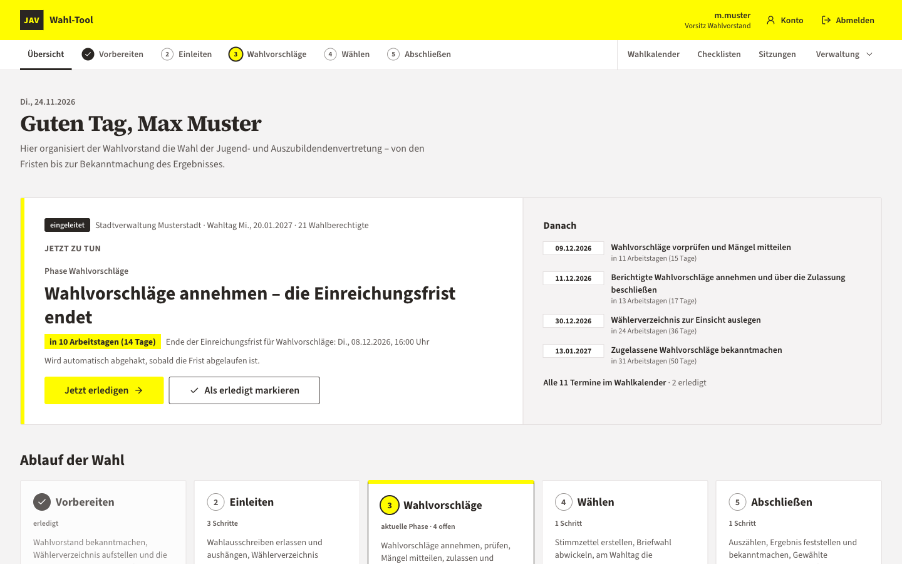
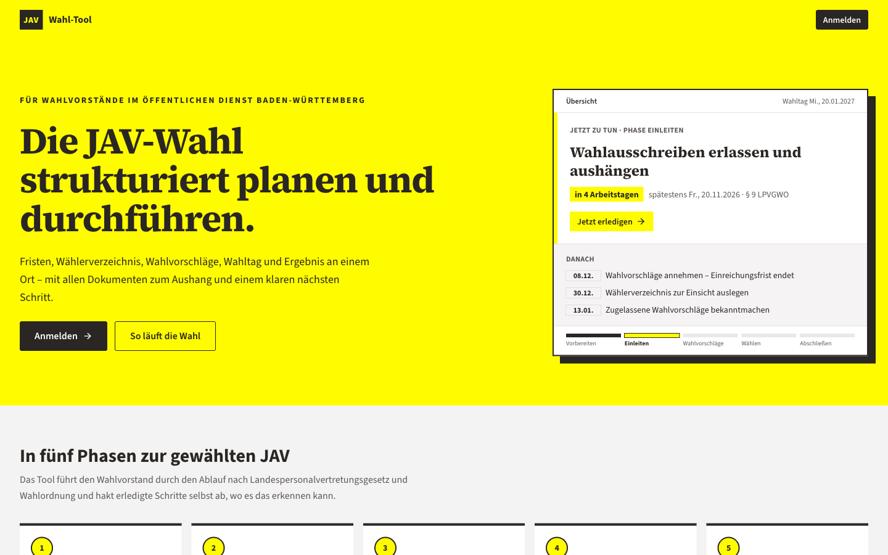
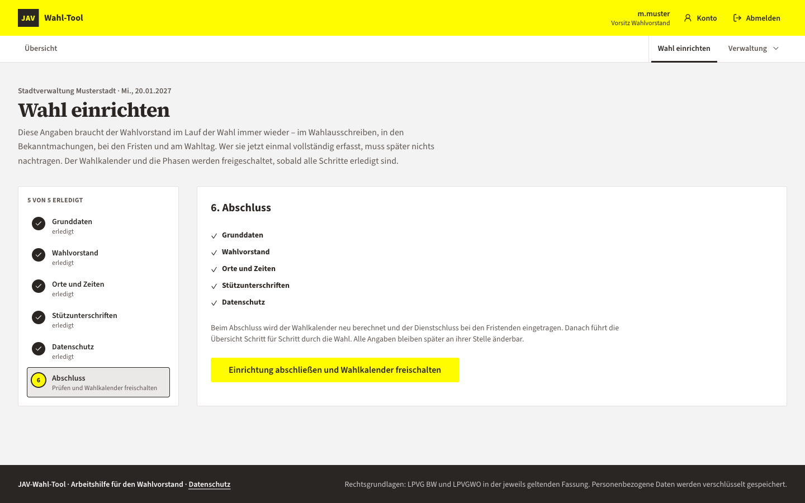
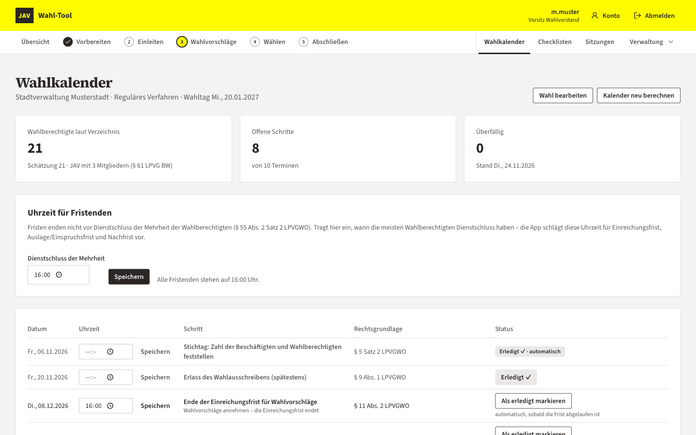
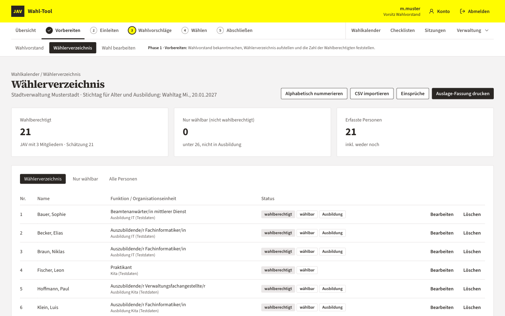
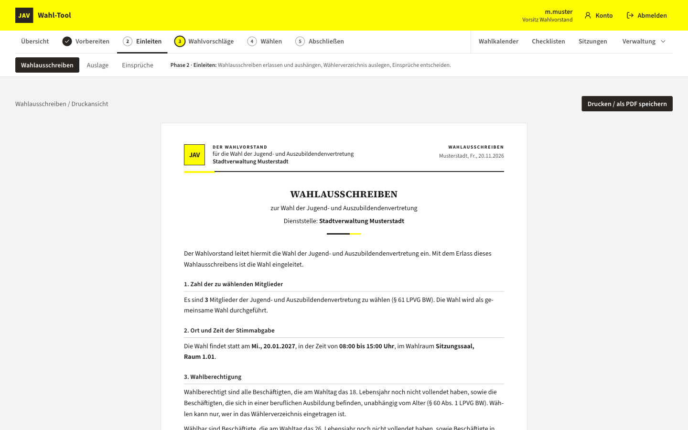
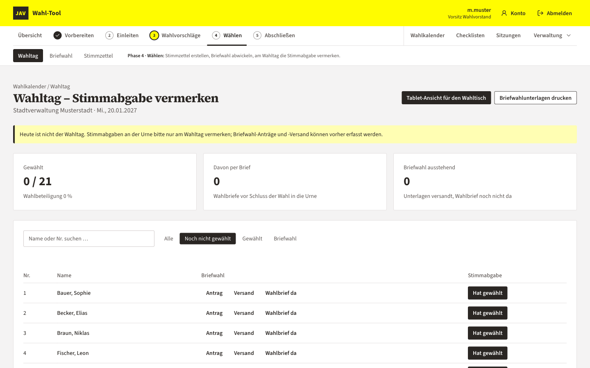

# JAV-Wahl-Tool

Webanwendung zur Unterstützung des Wahlvorstands bei der Wahl einer Jugend- und
Auszubildendenvertretung (JAV) im öffentlichen Dienst in Baden-Württemberg nach dem
Landespersonalvertretungsgesetz (LPVG) und seiner Wahlordnung (LPVGWO).

> [!WARNING]
> **Experimentelles Privatprojekt.** Dieses Tool wird von keiner offiziellen Stelle
> herausgegeben oder unterstützt – weder vom Land Baden-Württemberg noch von einer
> Behörde, Dienststelle, Gewerkschaft oder Personalvertretung. Es ist nicht für den
> produktiven Einsatz freigegeben.

> [!IMPORTANT]
> **Keine Rechtsberatung.** Fristen, Musterschreiben und Bekanntmachungen beruhen auf
> einer Vorrecherche und sind in der Anwendung als „ungeprüft“ gekennzeichnet. Vor jeder
> Verwendung sind sie gegen die amtliche Fassung von LPVG und LPVGWO
> ([landesrecht-bw.de](https://www.landesrecht-bw.de)) zu prüfen. Die Verantwortung für
> eine ordnungsgemäße Wahl liegt beim Wahlvorstand.



<sub>Alle Screenshots zeigen eine Demo-Instanz mit frei erfundenen Daten.</sub>

## Inhalt

- [Funktionsumfang](#funktionsumfang)
- [Screenshots](#screenshots)
- [Technik](#technik)
- [Installation](#installation)
- [Rollen und Berechtigungen](#rollen-und-berechtigungen)
- [Sicherheit und Datenschutz](#sicherheit-und-datenschutz)
- [Projektstruktur](#projektstruktur)
- [Entwicklung](#entwicklung)
- [Offene Punkte](#offene-punkte)
- [Lizenz](#lizenz)

## Funktionsumfang

Die Anwendung begleitet den Wahlvorstand durch alle Phasen einer JAV-Wahl:

| Phase             | Funktionen                                                                                                                                |
| ----------------- | ----------------------------------------------------------------------------------------------------------------------------------------- |
| Vorbereitung      | Einrichtungsassistent, Wahlvorstand und Ersatzmitglieder, Einladung zur konstituierenden Sitzung, Sitzungsniederschrift                   |
| Fristen           | Wahlkalender mit Arbeitstagen nach § 55 LPVGWO und gesetzlichen Feiertagen in Baden-Württemberg; Fristregeln einzeln prüf- und freigebbar |
| Wählerverzeichnis | CSV-Import mit Spaltenzuordnung, Prüfung von Wahlberechtigung und Wählbarkeit, Auslageversion, Einsprüche mit Entscheidungsschreiben      |
| Wahlausschreiben  | Erfassung aller Angaben, Druckfassung, Geschlechterverteilung und Sitzzahl                                                                |
| Wahlvorschläge    | Vordruck, Erfassung und Prüfung, Mängel- und Zurückweisungsschreiben, Nachfrist, Bekanntmachung                                           |
| Wahltag           | Stimmzettel, Briefwahl, Stimmabgabevermerke (auch durch Wahlhelfer), Urnenansicht                                                         |
| Ergebnis          | Auszählung nach Verhältnis- oder Mehrheitswahl, Losentscheid, Wahlniederschrift, Bekanntmachung, Benachrichtigung der Gewählten           |
| Nachbereitung     | Checklisten je Phase, Aufbewahrungs- und Löschfristen, Audit-Log                                                                          |

Alle Schreiben und Aushänge werden als druckoptimierte Seiten erzeugt. Für die
Datenschutz-Dokumentation erstellt die Anwendung Entwürfe für Verarbeitungsverzeichnis,
TOM, Datenschutz-Folgenabschätzung und Datenschutzhinweis.

## Screenshots

<table>
  <tr>
    <td width="50%" valign="top">
      <a href="docs/screenshots/start.png"></a>
      <p><b>Startseite</b><br>Öffentliche Einstiegsseite mit Überblick über den Ablauf in fünf Phasen; alle weiteren Bereiche erfordern eine Anmeldung.</p>
    </td>
    <td width="50%" valign="top">
      <a href="docs/screenshots/einrichtung.png"></a>
      <p><b>Einrichtungsassistent</b><br>Grunddaten, Wahlvorstand, Orte und Zeiten, Stützunterschriften und Datenschutz werden einmal vollständig erfasst, bevor der Wahlkalender freigeschaltet wird.</p>
    </td>
  </tr>
  <tr>
    <td width="50%" valign="top">
      <a href="docs/screenshots/wahlkalender.png"></a>
      <p><b>Wahlkalender</b><br>Alle Fristen werden vom Wahltag aus berechnet – mit Uhrzeit des Fristendes, Rechtsgrundlage und Erledigt-Status.</p>
    </td>
    <td width="50%" valign="top">
      <a href="docs/screenshots/waehlerverzeichnis.png"></a>
      <p><b>Wählerverzeichnis</b><br>Wahlberechtigung und Wählbarkeit werden zum Wahltag automatisch geprüft; Import per CSV, Auslagefassung zum Drucken.</p>
    </td>
  </tr>
  <tr>
    <td width="50%" valign="top">
      <a href="docs/screenshots/wahlausschreiben.png"></a>
      <p><b>Wahlausschreiben</b><br>Das Dokument wird aus den erfassten Angaben und dem Wahlkalender erzeugt und als versionierte Freigabe festgehalten.</p>
    </td>
    <td width="50%" valign="top">
      <a href="docs/screenshots/wahltag.png"></a>
      <p><b>Wahltag</b><br>Stimmabgabe und Briefwahl vermerken, mit Suche, Filtern und einer Tablet-Ansicht für den Wahltisch.</p>
    </td>
  </tr>
</table>

## Technik

| Bereich               | Einsatz                                                    |
| --------------------- | ---------------------------------------------------------- |
| Framework             | Next.js 16 (App Router), React 19, TypeScript (strict)     |
| Oberfläche            | Tailwind CSS 4, shadcn/ui                                  |
| Authentifizierung     | better-auth 1.7 (Benutzername und Passwort, optional TOTP) |
| Datenbank             | MariaDB 11 oder MySQL 8 über Prisma ORM 7                  |
| Validierung und Tests | Zod, Vitest                                                |
| Betrieb               | Node.js ≥ 20.9 (empfohlen 22), Docker-Image (standalone)   |

## Installation

### Voraussetzungen

- Node.js ≥ 20.9 und pnpm (`corepack enable pnpm`)
- Eine MariaDB- oder MySQL-Datenbank mit eigenem Benutzer und minimalen Rechten (nicht `root`)

### Einrichtung

```bash
pnpm install
cp .env.example .env.local        # Datenbankzugang und Secrets eintragen
```

`BETTER_AUTH_SECRET` und `DATA_ENCRYPTION_KEY` jeweils mit `openssl rand -base64 32`
erzeugen. Der Schlüssel für die Feldverschlüsselung muss getrennt von den Datensicherungen
aufbewahrt werden – ohne ihn sind verschlüsselte Felder nicht wiederherstellbar.

```bash
pnpm db:migrate                   # Prisma-Client generieren und Migrationen anwenden
pnpm user:create admin admin "IT-Administration"
pnpm user:create m.muster vorsitz "Max Muster"
pnpm dev                          # http://localhost:3000
```

Beim ersten Login muss jedes Konto sein Startpasswort ändern.

### Produktivbetrieb mit Docker

```bash
docker build -t jav-wahl-tool .
pnpm db:deploy                    # Migrationen gegen die Zieldatenbank anwenden
docker run --env-file .env.production -p 3000:3000 jav-wahl-tool
```

Im Produktivbetrieb sind HTTPS und eine per TLS erreichbare Datenbank (`DB_SSL=true`)
erforderlich.

## Rollen und Berechtigungen

| Rolle         | Berechtigungen                                                                                                                  |
| ------------- | ------------------------------------------------------------------------------------------------------------------------------- |
| `admin`       | Benutzerkonten verwalten, Audit-Log einsehen, Datenschutz-Angaben pflegen – **kein** Zugriff auf Wahldaten                      |
| `vorsitz`     | Vollzugriff auf die Wahl, Freigabe von Dokumenten und Fristregeln, Feststellung des Ergebnisses                                 |
| `mitglied`    | Wählerverzeichnis, Wahlvorschläge und Wahlkalender bearbeiten                                                                   |
| `wahlhelfer`  | Stimmabgabe vermerken, Fristen einsehen                                                                                         |
| `datenschutz` | Datenschutzbeauftragte/r: Datenschutz-Angaben pflegen, Aufgaben abhaken, Unterlagen einreichen – **kein** Zugriff auf Wahldaten |

Berechtigungen werden bei jeder Seite und jeder Server Action serverseitig geprüft
([src/lib/rbac.ts](src/lib/rbac.ts)).

## Sicherheit und Datenschutz

**Zugang**

- Keine Selbstregistrierung; Konten werden ausschließlich durch die Administration angelegt
- Passwörter mit mindestens 12 Zeichen, gehasht durch better-auth (scrypt)
- Kontosperre für 15 Minuten nach 5 Fehlversuchen, zusätzlich Rate-Limit
- Optionale Zwei-Faktor-Anmeldung (TOTP)
- Sitzungen serverseitig gespeichert, maximal 8 Stunden; Cookies `HttpOnly`, `SameSite=Strict`, in Produktion `Secure`

**Daten**

- Geburtsdatum, Ausbildungsende und Einspruchsbegründungen sind mit AES-256-GCM verschlüsselt
- Audit-Log ohne Inhalte; IP-Adressen nur als HMAC
- Löschkonzept nach § 32 LPVGWO mit Löschung je Wahl

**Auslieferung**

- Content-Security-Policy mit Nonce, HSTS, `X-Frame-Options: DENY`, `Referrer-Policy: no-referrer`
- Keine externen Skripte, Schriften, CDNs oder Analysedienste

## Projektstruktur

```
prisma/                 Datenbankschema und Migrationen
scripts/                Konten anlegen, Testdaten, Entwicklungs-Reset
src/
  app/                  Seiten und Server Actions (App Router)
    (app)/              geschützter Bereich
    login/, passwort/   Anmeldung, Passwortwechsel, 2FA
    urne/               Urnenansicht am Wahltag
  components/           gemeinsame Komponenten und Druckvorlagen
  lib/                  Fachlogik ohne Datenbankzugriff (Fristen, Wahlberechtigung,
                        Ergebnisberechnung, CSV-Import, Verschlüsselung, Rollen) mit Tests
  server/               Datenbankzugriffe je Fachbereich
  proxy.ts              Content-Security-Policy und Anmeldeweiterleitung
```

## Entwicklung

| Befehl                | Zweck                                                                         |
| --------------------- | ----------------------------------------------------------------------------- |
| `pnpm dev`            | Entwicklungsserver                                                            |
| `pnpm typecheck`      | TypeScript-Prüfung                                                            |
| `pnpm lint`           | ESLint                                                                        |
| `pnpm test`           | Unit-Tests (Vitest)                                                           |
| `pnpm build`          | Produktions-Build                                                             |
| `pnpm seed:dummy`     | Erfundene Testpersonen für die laufende Wahl anlegen (nicht in Produktion)    |
| `pnpm dev:reset --ja` | Alle Wahldaten löschen, Benutzerkonten bleiben erhalten (nicht in Produktion) |
| `pnpm db:studio`      | Prisma Studio                                                                 |

## Offene Punkte

- [ ] Fristwerte und Muster gegen die amtliche Fassung von LPVG und LPVGWO prüfen
- [ ] Datenschutz-Unterlagen mit der/dem Datenschutzbeauftragten abstimmen
- [ ] Verschlüsselte Datensicherung einrichten und Wiederherstellung testen
- [ ] Externe Sicherheitsprüfung vor einem produktiven Einsatz

## Lizenz

Copyright © 2026 Benjamin Esenwein

Lizenziert unter der EUPL, Version 1.2 ([SPDX: EUPL-1.2](https://spdx.org/licenses/EUPL-1.2.html)).
Der vollständige Lizenztext in der amtlichen deutschen Fassung steht in [LICENSE](LICENSE)
(Quelle: Durchführungsbeschluss (EU) 2017/863, ABl. L 128 vom 19.5.2017, S. 59). Alle
Sprachfassungen der EUPL sind gleichwertig; weitere Fassungen bietet die
[Europäische Kommission](https://interoperable-europe.ec.europa.eu/collection/eupl/eupl-text-eupl-12) an.

Die Software wird ohne Gewährleistung bereitgestellt; siehe Artikel 7 und 8 der Lizenz.
