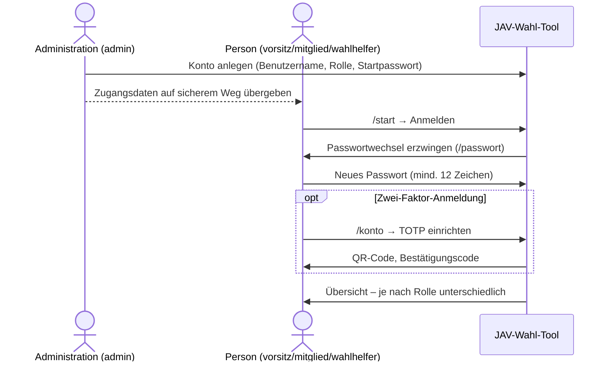

# 01 · Zugang und Benutzerkonten

[← Übersicht](README.md)

| | |
| --- | --- |
| **Rollen** | `admin` legt an; alle Rollen melden sich an |
| **Auslöser** | Der Wahlvorstand ist bestellt und braucht Zugang zur Anwendung |
| **Ergebnis** | Jede beteiligte Person hat ein eigenes Konto mit passender Rolle und eigenem Passwort |

## Ablauf

## Schritte

| # | Wer | Was | Wo |
| --- | --- | --- | --- |
| 1 | admin | Konten anlegen – entweder per Kommandozeile (`pnpm user:create <name> <rolle> "<Anzeigename>"`) oder in der Anwendung | Verwaltung → Benutzer (`/benutzer`) |
| 2 | admin | Startpasswort außerhalb der Anwendung übergeben | – |
| 3 | Person | Öffentliche Startseite aufrufen und anmelden | `/start`, `/login` |
| 4 | Person | Startpasswort durch eigenes Passwort ersetzen; vorher ist keine andere Seite erreichbar | `/passwort` |
| 5 | Person | Optional: Zwei-Faktor-Anmeldung einrichten; danach wird bei jeder Anmeldung ein Code abgefragt | `/konto`, `/login/2fa` |
| 6 | Person | Landet auf der Übersicht (`/`); was sie sieht, hängt von der Rolle ab (siehe [Journey 10](10-taegliche-arbeit.md)) | `/` |

## Konten pflegen (admin)

Auf `/benutzer` kann die Administration:

- Passwort zurücksetzen – die Person muss es bei der nächsten Anmeldung wieder ändern
- Rolle ändern (z. B. wenn ein Mitglied den Vorsitz übernimmt)
- Konto sperren und entsperren
- Alle Sitzungen einer Person beenden (z. B. bei verlorenem Gerät)

## Schutzmechanismen

- Keine Selbstregistrierung – Konten entstehen nur durch die Administration
- Sperre für 15 Minuten nach 5 Fehlversuchen, zusätzlich Rate-Limit
- Sitzungen laufen nach höchstens 8 Stunden ab
- Nach der Anmeldung führt ein Rücksprung nur auf Seiten der Anwendung (keine fremden Adressen)
- `admin` sieht **keine** Wahldaten – die Rolle ist bewusst von der Wahl getrennt

## Stolpersteine

- Wer sich mit einem Startpasswort anmeldet, kommt nicht weiter, bevor es geändert ist. Das ist gewollt.
- Für den Wahltag rechtzeitig Konten mit der Rolle `wahlhelfer` anlegen – diese Rolle kann nur Stimmabgaben vermerken.
