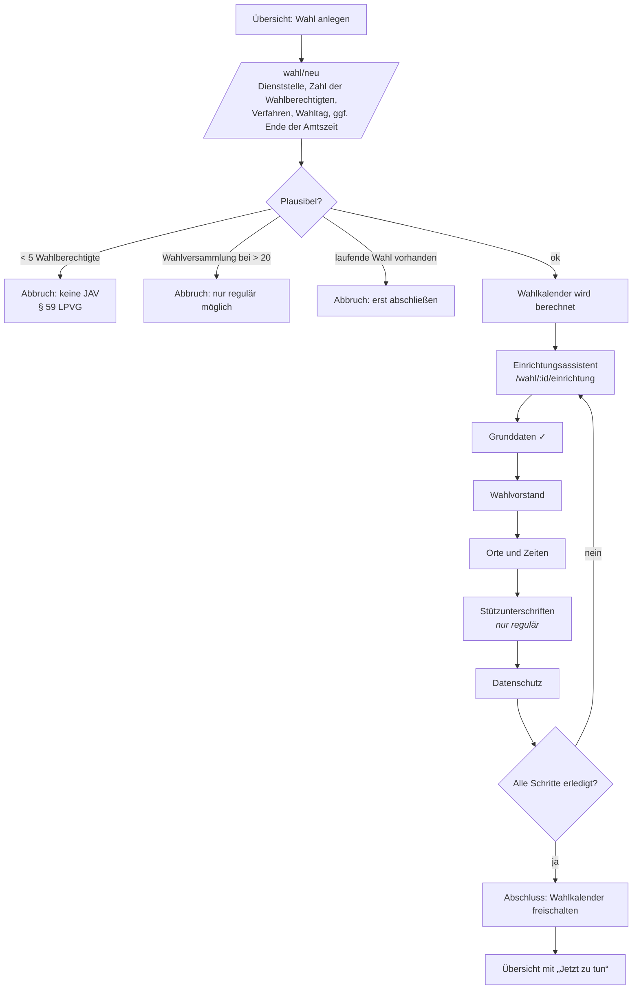

# 02 · Wahl anlegen und einrichten

[← Übersicht](README.md)

|              |                                                                                           |
| ------------ | ----------------------------------------------------------------------------------------- |
| **Rolle**    | `vorsitz` (andere Rollen sehen nur den Hinweis „Der Vorsitz richtet die Wahl gerade ein“) |
| **Auslöser** | Der Wahlvorstand ist bestellt, der Wahltag steht fest                                     |
| **Ergebnis** | Eine Wahl mit berechnetem Wahlkalender; die Phasen-Navigation ist freigeschaltet          |

## Ablauf

## Schritte

| #   | Was                 | Details                                                                                                                                                                                                                                                       | Wo          |
| --- | ------------------- | ------------------------------------------------------------------------------------------------------------------------------------------------------------------------------------------------------------------------------------------------------------- | ----------- |
| 1   | Wahl anlegen        | Dienststelle, geschätzte Zahl der Wahlberechtigten, Verfahren (regulär oder Wahlversammlung), Wahltag, bei Wahlversammlung das Ende der Amtszeit                                                                                                              | `/wahl/neu` |
| 2   | Grunddaten          | Ist nach dem Anlegen automatisch erledigt                                                                                                                                                                                                                     | Einrichtung |
| 3   | Wahlvorstand        | Mitglieder und Ersatzmitglieder; nötig sind ein Vorsitz, mindestens drei Mitglieder und mindestens ein in den Personalrat wählbares Mitglied                                                                                                                  | Einrichtung |
| 4   | Orte und Zeiten     | Ausstellungsort, Dienstschluss, Stelle für Wahlvorschläge und Einsprüche, Ort der Bekanntmachungen, Auslage (Ort, Zeiten), Wahlraum, Wahlzeit, Ort und Beginn der Auszählung, optional Hinweis zur Briefwahl. Bei der Wahlversammlung deutlich weniger Felder | Einrichtung |
| 5   | Stützunterschriften | Mindestzahl für Wahlvorschläge der Beschäftigten (nur reguläres Verfahren)                                                                                                                                                                                    | Einrichtung |
| 6   | Datenschutz         | Verantwortliche Stelle und Datenschutzbeauftragte/r                                                                                                                                                                                                           | Einrichtung |
| 7   | Abschluss           | Prüfen und Wahlkalender freischalten; danach Weiterleitung zur Übersicht                                                                                                                                                                                      | Einrichtung |

## Was danach anders ist

- Die Navigation zeigt die Phasen (z. B. _1 Vorbereiten … 5 Abschließen_) sowie _Wahlkalender_,
  _Aushänge_, _Checklisten_ und _Sitzungen_.
- Die Übersicht zeigt den nächsten fälligen Schritt (siehe [Journey 10](10-taegliche-arbeit.md)).
- Die Angaben aus „Orte und Zeiten“ erscheinen in allen Dokumenten, der Dienstschluss bestimmt die Uhrzeit der Fristenden.

## Stolpersteine

- Es kann immer nur **eine** laufende Wahl geben. Eine neue Wahl ist erst möglich, wenn die alte abgeschlossen ist.
- Ändert sich später der Wahltag, unter _Vorbereiten → Wahl bearbeiten_ (`/wahl/:id/bearbeiten`) anpassen; der Wahlkalender wird neu berechnet.
- Fehlende Angaben zeigt der Assistent je Schritt als Liste „Was noch fehlt“ an.
