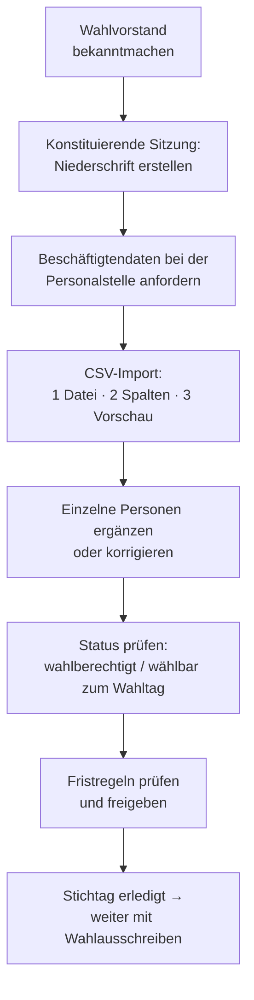

# 03 · Wahl vorbereiten (Phase 1)

[← Übersicht](README.md)

| | |
| --- | --- |
| **Rollen** | `vorsitz`, `mitglied` |
| **Auslöser** | Einrichtung abgeschlossen |
| **Ergebnis** | Wahlvorstand bekanntgemacht, Wählerverzeichnis vollständig, Zahl der Wahlberechtigten festgestellt, Fristregeln geprüft |
| **Frist** | Stichtag: 10 Arbeitstage vor Erlass des Wahlausschreibens (§ 5 Satz 2 LPVGWO) |

## Ablauf

## Schritte

| # | Wer | Was | Wo |
| --- | --- | --- | --- |
| 1 | vorsitz | Zusammensetzung des Wahlvorstands prüfen und die Bekanntmachung drucken und aushängen | *Vorbereiten → Wahlvorstand* (`/wahl/:id/wahlvorstand`, `…/bekanntmachung`) |
| 2 | vorsitz, mitglied | Niederschrift über die Sitzung des Wahlvorstands erzeugen (Anwesende, Beschlüsse) | *Sitzungen* (`/wahl/:id/sitzung`) |
| 3 | vorsitz, mitglied | Beschäftigtendaten als CSV importieren: Datei wählen, Spalten zuordnen, Vorschau prüfen, übernehmen | *Wählerverzeichnis → Import* (`/wahl/:id/waehler/import`) |
| 4 | vorsitz, mitglied | Einzelne Personen anlegen, bearbeiten, löschen; Nummerierung neu vergeben | *Wählerverzeichnis* (`/wahl/:id/waehler`) |
| 5 | vorsitz, mitglied | Ergebnis der automatischen Prüfung durchsehen: Wahlberechtigung und Wählbarkeit werden zum Wahltag aus Geburtsdatum und Ausbildungsende berechnet | *Wählerverzeichnis* |
| 6 | vorsitz | Fristregeln einzeln prüfen und freigeben | *Verwaltung → Fristregeln* (`/fristen/regeln`) |

## Datenschutz im Wählerverzeichnis

- Geburtsdatum und Ausbildungsende werden verschlüsselt gespeichert.
- `wahlhelfer` sieht diese Angaben nicht.
- Der Import überträgt nur die zugeordneten Spalten.

## Stolpersteine

- Unter 18-Jährige **und** alle Auszubildenden gehören ins Verzeichnis, Außenstellen nicht vergessen (Checkliste *Vorbereitung*).
- Die geschätzte Zahl aus dem Anlegen der Wahl gilt nur, bis Personen erfasst sind; danach zählt das Verzeichnis.
- Der Schritt „Stichtag“ wird automatisch abgehakt, sobald das Wahlausschreiben freigegeben ist.
