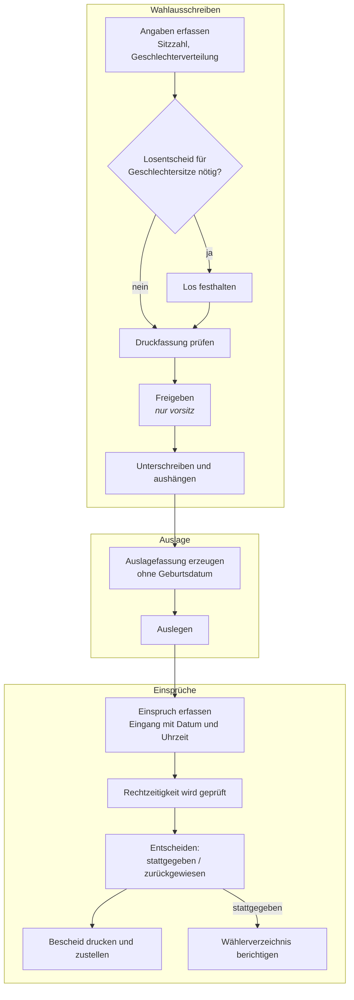

# 04 · Wahl einleiten (Phase 2)

[← Übersicht](README.md)

|              |                                                                                                                      |
| ------------ | -------------------------------------------------------------------------------------------------------------------- |
| **Rollen**   | `vorsitz` (Angaben, Freigabe), `mitglied` (Auslage, Einsprüche)                                                      |
| **Auslöser** | Wählerverzeichnis steht, Termin „Erlass des Wahlausschreibens“ rückt näher                                           |
| **Ergebnis** | Wahlausschreiben freigegeben und ausgehängt, Wählerverzeichnis ausgelegt, alle Einsprüche entschieden und mitgeteilt |

## Fristen dieser Phase

| Termin                                   | Regel                                     | Rechtsgrundlage          |
| ---------------------------------------- | ----------------------------------------- | ------------------------ |
| Erlass des Wahlausschreibens             | spätestens 2 Monate vor dem Wahltag       | § 9 Abs. 1 LPVGWO        |
| Beginn der Auslage                       | spätestens 12 Arbeitstage vor dem Wahltag | § 6 Abs. 4 Satz 1 LPVGWO |
| Ende der Auslage und Einspruchsfrist     | 2 Arbeitstage vor dem Wahltag             | § 6 Abs. 4, 5 LPVGWO     |
| Entscheidungen über Einsprüche mitteilen | spätestens 1 Arbeitstag vor dem Wahltag   | § 6 Abs. 6 Satz 2 LPVGWO |

## Ablauf

## Schritte

| #   | Wer               | Was                                                                                                                  | Wo                                                            |
| --- | ----------------- | -------------------------------------------------------------------------------------------------------------------- | ------------------------------------------------------------- |
| 1   | vorsitz           | Angaben zum Wahlausschreiben vervollständigen; die Anwendung ermittelt Sitzzahl und Verteilung auf Frauen und Männer | _Einleiten → Wahlausschreiben_ (`/wahl/:id/wahlausschreiben`) |
| 2   | vorsitz           | Bei Gleichstand der Geschlechterverteilung den Losentscheid festhalten                                               | Wahlausschreiben                                              |
| 3   | vorsitz           | Druckfassung prüfen und freigeben – die Freigabe wird als Version festgehalten                                       | `…/wahlausschreiben/druck`                                    |
| 4   | vorsitz           | Ausdruck unterschreiben und am Bekanntmachungsort aushängen, zusätzlich elektronisch                                 | außerhalb der Anwendung                                       |
| 5   | mitglied          | Auslagefassung des Wählerverzeichnisses erzeugen und auslegen                                                        | _Einleiten → Auslage_ (`/wahl/:id/waehler/auslage`)           |
| 6   | mitglied          | Einsprüche mit Eingangszeitpunkt und Begründung erfassen, optional einer Person zuordnen                             | _Einleiten → Einsprüche_ (`/wahl/:id/einsprueche`)            |
| 7   | vorsitz, mitglied | Entscheiden (stattgegeben/zurückgewiesen, mit Grund) und Bescheid drucken                                            | `…/einsprueche/:oid/bescheid`                                 |
| 8   | mitglied          | Bei Stattgabe das Wählerverzeichnis berichtigen                                                                      | _Wählerverzeichnis_                                           |

## Automatisch erledigt

- „Erlass des Wahlausschreibens“ und „Stichtag“: sobald das Wahlausschreiben freigegeben ist
- „Beginn der Auslage“: sobald die Auslagefassung erzeugt und der Termin erreicht ist
- „Ende der Auslage“: sobald die Frist abgelaufen ist
- „Einsprüche entscheiden“: sobald die Auslage beendet und jeder Einspruch entschieden ist

## Stolpersteine

- Das Aushängen selbst kann die Anwendung nicht erkennen. Der Zeitraum steht unter _Aushänge_ (`/wahl/:id/aushaenge`).
- Einspruchsbegründungen werden verschlüsselt gespeichert und erscheinen nicht im Audit-Log.
