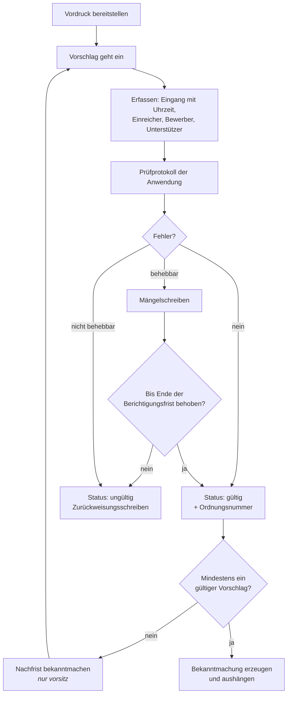

# 05 · Wahlvorschläge bearbeiten (Phase 3)

[← Übersicht](README.md)

|              |                                                                                                   |
| ------------ | ------------------------------------------------------------------------------------------------- |
| **Rollen**   | `vorsitz`, `mitglied` (Nachfrist: nur `vorsitz`)                                                  |
| **Auslöser** | Das Wahlausschreiben ist erlassen, die Einreichungsfrist läuft                                    |
| **Ergebnis** | Alle Wahlvorschläge geprüft und entschieden, gültige Vorschläge mit Ordnungsnummer bekanntgemacht |

## Fristen dieser Phase

| Termin                                     | Regel                                            | Rechtsgrundlage           |
| ------------------------------------------ | ------------------------------------------------ | ------------------------- |
| Ende der Einreichungsfrist                 | 12 Arbeitstage nach Erlass des Wahlausschreibens | § 11 Abs. 2 LPVGWO        |
| Mängel mitteilen                           | spätestens 13 Arbeitstage nach Erlass            | § 14 Abs. 2 Satz 1 LPVGWO |
| Ende der Berichtigungsfrist                | 15 Arbeitstage nach Erlass                       | § 14 Abs. 2 Satz 3 LPVGWO |
| Bekanntmachung der zugelassenen Vorschläge | spätestens 5 Arbeitstage vor dem Wahltag         | § 18 Abs. 1 Satz 1 LPVGWO |

## Ablauf

## Schritte

| #   | Was                                                                                                                       | Wo                                                             |
| --- | ------------------------------------------------------------------------------------------------------------------------- | -------------------------------------------------------------- |
| 1   | Vordruck für Wahlvorschläge drucken und bereitstellen                                                                     | _Wahlvorschläge → Vordruck_ (`/wahl/:id/vorschlaege/vordruck`) |
| 2   | Eingegangenen Vorschlag anlegen: Einreicher (Beschäftigte oder Gewerkschaft), Eingang mit Datum und Uhrzeit               | _Wahlvorschläge_ (`/wahl/:id/vorschlaege`)                     |
| 3   | Bewerberinnen und Bewerber in Listenreihenfolge erfassen, Zustimmung abhaken; Unterstützerinnen und Unterstützer erfassen | `/wahl/:id/vorschlaege/:nid`                                   |
| 4   | Prüfprotokoll lesen (siehe unten) und ggf. Begründung zur Geschlechterverteilung erfassen                                 | Vorschlag                                                      |
| 5   | Entscheidung treffen: _eingegangen_, _gültig_, _ungültig_ oder _zurückgegeben_, mit Prüfnotiz und Ordnungsnummer          | Vorschlag                                                      |
| 6   | Mängel- bzw. Zurückweisungsschreiben drucken                                                                              | `…/vorschlaege/:nid/schreiben`                                 |
| 7   | Falls kein gültiger Vorschlag vorliegt: Nachfrist bekanntmachen – die Seite _Nachfrist_ wird erst dann freigeschaltet     | `…/vorschlaege/nachfrist`                                      |
| 8   | Bekanntmachung der zugelassenen Vorschläge erzeugen und aushängen                                                         | `…/vorschlaege/bekanntmachung`                                 |

## Was das Prüfprotokoll prüft

Das Protokoll ist eine Arbeitshilfe, die Entscheidung trifft der Wahlvorstand
([src/lib/vorschlaege.ts](../../src/lib/vorschlaege.ts)).

| Prüfung                                               | Ergebnis                           |
| ----------------------------------------------------- | ---------------------------------- |
| Eingang vor Fristende                                 | ok / Fehler „verspätet“            |
| Mindestens eine Bewerberin oder ein Bewerber          | Fehler, wenn leer                  |
| Wählbarkeit aller Bewerber (§ 60 Abs. 2 LPVG)         | Fehler mit Namen                   |
| Schriftliche Zustimmung aller Bewerber                | Fehler mit Namen                   |
| Geschlechterverteilung (§ 8, § 12 LPVGWO)             | Hinweis/Fehler, Begründung möglich |
| Person auf mehreren Vorschlägen                       | Hinweis                            |
| Unterstützer wahlberechtigt, nicht doppelt            | Fehler bzw. Hinweis                |
| Mindestzahl an Stützunterschriften (nur Beschäftigte) | ok / Fehler                        |
| Name der Gewerkschaft (nur Gewerkschaftsvorschlag)    | ok / Fehler                        |

## Automatisch erledigt

- Fristenden: sobald die Frist abgelaufen ist
- „Mängel mitteilen“: Einreichungsfrist abgelaufen und kein Vorschlag mehr im Status _eingegangen_
- „Bekanntmachung“: Bekanntmachung nach der letzten Vorschlagsfrist erzeugt und alle Vorschläge geprüft

## Stolpersteine

- Eine Bekanntmachung, die **vor** Ablauf der letzten Frist erzeugt wurde, zählt nicht – nach Fristablauf neu erzeugen.
- Die Nachfrist kann erst nach Ablauf der regulären Einreichungsfrist gesetzt werden.
