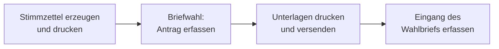
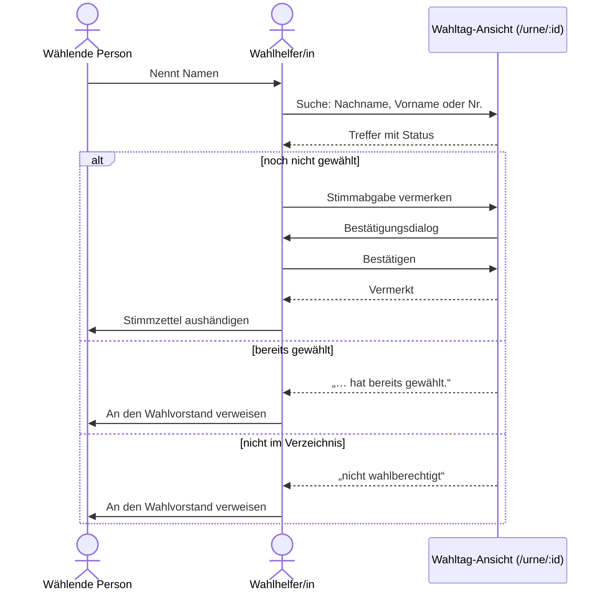

# 06 · Briefwahl und Wahltag (Phase 4)

[← Übersicht](README.md)

|              |                                                                                                      |
| ------------ | ---------------------------------------------------------------------------------------------------- |
| **Rollen**   | `vorsitz`, `mitglied` (Briefwahl, Stimmzettel, Korrekturen), `wahlhelfer` (Stimmabgabe am Wahltisch) |
| **Auslöser** | Die Wahlvorschläge sind bekanntgemacht, der Wahltag naht                                             |
| **Ergebnis** | Jede Stimmabgabe ist genau einmal im Wählerverzeichnis vermerkt, Wahlbriefe sind erfasst             |

## Teil A – Vor dem Wahltag (Wahlvorstand)

| #   | Was                                                                                                                                                           | Wo                                                   |
| --- | ------------------------------------------------------------------------------------------------------------------------------------------------------------- | ---------------------------------------------------- |
| 1   | Stimmzettel aus den zugelassenen Vorschlägen erzeugen und drucken                                                                                             | _Wählen → Stimmzettel_ (`/wahl/:id/stimmzettel`)     |
| 2   | Briefwahl je Person in drei Schritten erfassen: **beantragt → versandt → eingegangen**. Jeder Schritt setzt den vorherigen voraus und lässt sich zurücknehmen | _Wählen → Briefwahl_ (`/wahl/:id/wahltag/briefwahl`) |
| 3   | Briefwahlunterlagen für alle noch nicht versandten Anträge gesammelt drucken                                                                                  | Briefwahl                                            |
| 4   | Wahlhelferinnen und Wahlhelfer einteilen; Konten mit Rolle `wahlhelfer` bei der Administration anfordern                                                      | [Journey 01](01-zugang-und-konten.md)                |

## Teil B – Am Wahltisch (Wahlhelfer/in)

| #   | Was                                                                            | Wo          |
| --- | ------------------------------------------------------------------------------ | ----------- |
| 1   | Anmelden; die Übersicht zeigt für `wahlhelfer` direkt „Wahltag-Ansicht öffnen“ | `/`         |
| 2   | Tablet-Ansicht am Wahltisch öffnen                                             | `/urne/:id` |
| 3   | Person suchen, Stimmabgabe vermerken, im Dialog bestätigen                     | `/urne/:id` |

## Teil C – Wahlvorstand am Wahltag

| #   | Was                                                                                                   | Wo                                       |
| --- | ----------------------------------------------------------------------------------------------------- | ---------------------------------------- |
| 1   | Stimmabgaben mit Suche und Filtern überblicken; ebenfalls vermerken                                   | _Wählen → Wahltag_ (`/wahl/:id/wahltag`) |
| 2   | Versehentlichen Vermerk zurücknehmen (nur Wahlvorstand, nicht `wahlhelfer`)                           | Wahltag                                  |
| 3   | Eingegangene Wahlbriefe vor Ende der Wahlzeit in die Urne geben und als Stimmabgabe „Brief“ vermerken | Wahltag                                  |
| 4   | Checkliste _Wahltag_ abarbeiten (Urne leer vorgezeigt, Unregelmäßigkeiten dokumentiert …)             | _Checklisten_                            |

## Schutzmechanismen

- Ein Vermerk ist nur möglich, solange noch keiner besteht – auch bei gleichzeitigen Klicks an zwei Tablets
- Vermerke nur für wahlberechtigte Personen
- Jeder Vermerk und jede Rücknahme steht mit Benutzer im Audit-Log
- `wahlhelfer` sieht keine verschlüsselten Personenangaben und kann nichts zurücknehmen

## Stolpersteine

- Später eingehende Wahlbriefe werden nicht berücksichtigt – die Briefwahlseite weist darauf hin.
