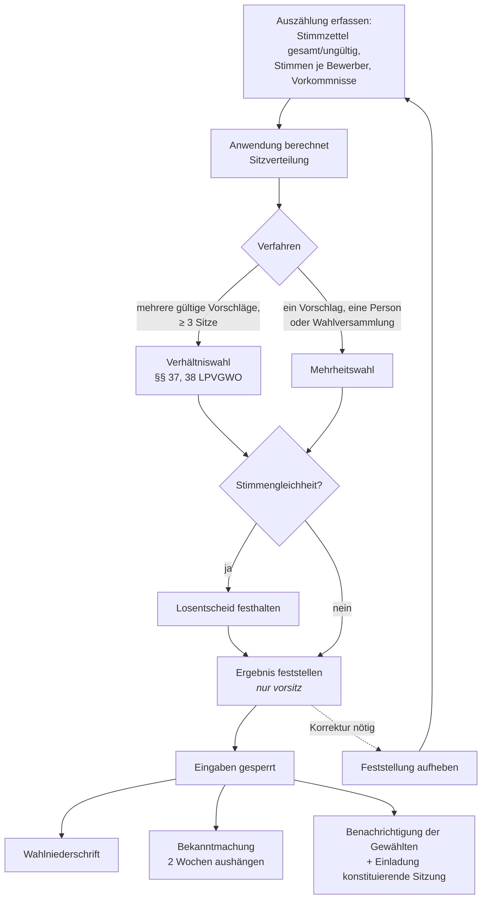

# 07 · Auszählung und Ergebnis (Phase 5)

[← Übersicht](README.md)

|              |                                                                                                                        |
| ------------ | ---------------------------------------------------------------------------------------------------------------------- |
| **Rollen**   | `mitglied` (Auszählung erfassen, Losentscheid), `vorsitz` (zusätzlich: Ergebnis feststellen und Feststellung aufheben) |
| **Auslöser** | Die Wahlzeit ist beendet, die öffentliche Auszählung beginnt                                                           |
| **Ergebnis** | Ergebnis festgestellt, Niederschrift, Bekanntmachung und Benachrichtigungen der Gewählten erzeugt                      |

## Ablauf

## Schritte

| #   | Wer               | Was                                                                                                                                                              | Wo                                              |
| --- | ----------------- | ---------------------------------------------------------------------------------------------------------------------------------------------------------------- | ----------------------------------------------- |
| 1   | mitglied          | Auszählung als Entwurf speichern: Stimmzettel insgesamt und ungültig, Stimmen je Bewerber, besondere Vorkommnisse                                                | _Abschließen → Ergebnis_ (`/wahl/:id/ergebnis`) |
| 2   | mitglied          | Bei Stimmengleichheit das Los ziehen und die Gewinner festhalten                                                                                                 | Ergebnis                                        |
| 3   | vorsitz           | Ergebnis feststellen – Gewählte und Ersatzmitglieder mit Rang werden gespeichert, weitere Eingaben gesperrt                                                      | Ergebnis                                        |
| 4   | vorsitz, mitglied | Wahlniederschrift drucken und unterschreiben                                                                                                                     | `…/ergebnis/niederschrift`                      |
| 5   | vorsitz, mitglied | Bekanntmachung des Ergebnisses drucken und aushängen                                                                                                             | `…/ergebnis/bekanntmachung`                     |
| 6   | vorsitz, mitglied | Benachrichtigungen der Gewählten drucken und zustellen, zur konstituierenden Sitzung einladen; Annahme bzw. Ablehnung über die Checkliste _Abschluss_ nachhalten | `…/ergebnis/benachrichtigung`                   |

Niederschrift, Bekanntmachung und Benachrichtigung sind erst ab Erfassung des Ergebnisses
verfügbar; vorher sind sie in der Navigation ausgegraut.

## Folgetermine im Wahlkalender

| Termin                                 | Hinweis                                                                          |
| -------------------------------------- | -------------------------------------------------------------------------------- |
| Einladung zur konstituierenden Sitzung | Empfehlung: 6 Arbeitstage nach dem Wahltag (keine gesetzliche Frist für die JAV) |
| Ende des Ergebnisaushangs              | zwei Wochen                                                                      |
| Ende der Anfechtungsfrist              | danach Abschluss und Löschung ([Journey 08](08-abschluss-und-loeschung.md))      |

## Stolpersteine

- „Ergebnis feststellen“ ist erst möglich, wenn die Auszählung vollständig, fehlerfrei und jeder Losentscheid erfasst ist.
- Für Änderungen nach der Feststellung muss der Vorsitz die Feststellung zuerst aufheben.
