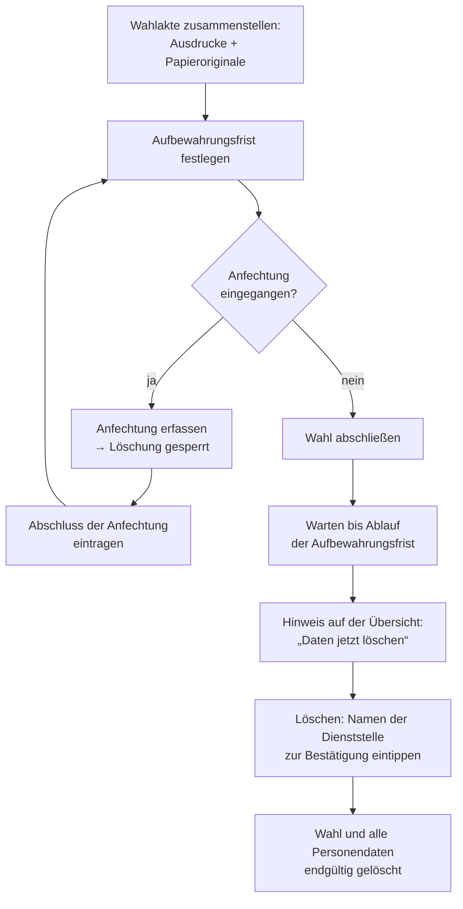

# 08 · Abschluss, Aufbewahrung und Löschung

[← Übersicht](README.md)

|              |                                                                                                                                                   |
| ------------ | ------------------------------------------------------------------------------------------------------------------------------------------------- |
| **Rollen**   | `vorsitz` (Wahlakte, Abschluss), `admin` und `vorsitz` (Aufbewahrung und Löschung)                                                                |
| **Auslöser** | Das Ergebnis ist festgestellt und bekanntgemacht                                                                                                  |
| **Ergebnis** | Wahlakte in Papierform an den Personalrat übergeben, Wahl abgeschlossen, nach Ablauf der Aufbewahrungsfrist alle personenbezogenen Daten gelöscht |

## Ablauf

## Schritte

| #   | Wer            | Was                                                                                                                                                                                                                     | Wo                                                     |
| --- | -------------- | ----------------------------------------------------------------------------------------------------------------------------------------------------------------------------------------------------------------------- | ------------------------------------------------------ |
| 1   | vorsitz        | Wahlakte nach § 32 LPVGWO zusammenstellen. Die Seite unterscheidet Dokumente, die **vor der Löschung** ausgedruckt werden müssen, und Papieroriginale, die nur beim Wahlvorstand liegen (Unterschriften, Stimmzettel …) | _Abschließen → Wahlakte_ (`/wahl/:id/wahlakte`)        |
| 2   | vorsitz        | Checkliste _Abschluss_ abarbeiten                                                                                                                                                                                       | _Checklisten_                                          |
| 3   | vorsitz, admin | Aufbewahrungsfrist festlegen; sie muss nach dem Ende der Anfechtungsfrist liegen                                                                                                                                        | _Abschließen → Abschluss & Löschung_ (`/aufbewahrung`) |
| 4   | vorsitz, admin | Ggf. eine Wahlanfechtung (§ 21 LPVG) mit Datum erfassen und später ihren Abschluss eintragen                                                                                                                            | `/aufbewahrung`                                        |
| 5   | vorsitz, admin | Wahl abschließen (setzt festgestelltes Ergebnis und Aufbewahrungsfrist voraus)                                                                                                                                          | `/aufbewahrung`                                        |
| 6   | vorsitz, admin | Nach Fristablauf löschen; zur Bestätigung den Namen der Dienststelle exakt eingeben                                                                                                                                     | `/aufbewahrung`                                        |

## Was gelöscht wird

Wählerverzeichnis, Einsprüche, Wahlvorschläge, Ergebnis, Dokumente, Fristen und
Checklisten der Wahl. Das Audit-Log bleibt erhalten; es enthält keine Inhalte, nur
Aktion, Objekt und geänderte Felder.

## Schutzmechanismen

- Löschen nur bei abgeschlossener Wahl und abgelaufener Aufbewahrungsfrist
- Eine laufende Anfechtung hebt eine gesetzte Aufbewahrungsfrist auf und sperrt die Löschung
- Bestätigung durch Eintippen des Dienststellennamens

## Stolpersteine

- **Vorher ausdrucken!** Nach der Löschung lassen sich Niederschrift, Bekanntmachungen und Schreiben nicht mehr erzeugen.
- Erst nach dem Abschluss kann eine neue Wahl angelegt werden.
