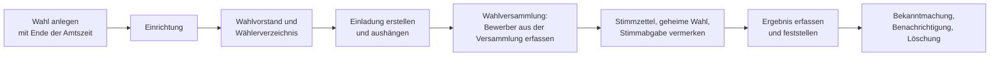

# 09 · Wahlversammlung (vereinfachtes Verfahren)

[← Übersicht](README.md)

| | |
| --- | --- |
| **Rollen** | `vorsitz`, `mitglied` |
| **Voraussetzung** | Höchstens 20 Wahlberechtigte (§ 62 Abs. 2 LPVG); beim Anlegen der Wahl Verfahren „Wahlversammlung“ gewählt |
| **Ergebnis** | JAV (eine Person) in der Wahlversammlung gewählt, Ergebnis bekanntgemacht |

## Unterschiede zum regulären Verfahren

| Thema | Regulär | Wahlversammlung |
| --- | --- | --- |
| Phasen | 5 | 4: Vorbereiten · Einladen · Wählen · Abschließen |
| Wahlausschreiben, Auslage, Einsprüche | ja | entfällt |
| Wahlvorschläge | schriftlich, mit Fristen | aus der Versammlung heraus |
| Stützunterschriften | Einrichtungsschritt | entfällt |
| Einrichtung „Orte und Zeiten“ | 12 Felder | 5 Felder (Ausstellungsort, Ort und Beginn der Versammlung, Bekanntmachungsort, Erreichbarkeit) |
| Fristen | vom Wahltag und Wahlausschreiben aus | Einberufung spätestens 4 Wochen vor Ende der Amtszeit (§ 62 Abs. 2 Satz 2 LPVG) |
| Wahlverfahren | Verhältnis- oder Mehrheitswahl | Mehrheitswahl |

## Ablauf

## Schritte

| # | Was | Wo |
| --- | --- | --- |
| 1 | Wahl mit Verfahren „Wahlversammlung“ und dem Ende der Amtszeit der bisherigen JAV anlegen | `/wahl/neu` |
| 2 | Einrichtung wie in [Journey 02](02-wahl-anlegen-und-einrichten.md), mit verkürztem Schritt „Orte und Zeiten“ | Einrichtung |
| 3 | Wahlvorstand bekanntmachen, Wählerverzeichnis aufstellen | wie [Journey 03](03-vorbereiten.md) |
| 4 | Einladung zur Wahlversammlung erstellen, drucken und aushängen | *Einladen → Einladung* (`/wahl/:id/einladung`) |
| 5 | In der Versammlung: Vorgeschlagene Personen als Bewerber erfassen | *Abschließen → Ergebnis* |
| 6 | Stimmzettel drucken, Stimmabgabe vermerken | *Wählen → Stimmzettel*, *Wählen → Wahlversammlung* |
| 7 | Ergebnis erfassen, feststellen und bekanntmachen, dann abschließen | [Journey 07](07-ergebnis.md), [Journey 08](08-abschluss-und-loeschung.md) |
