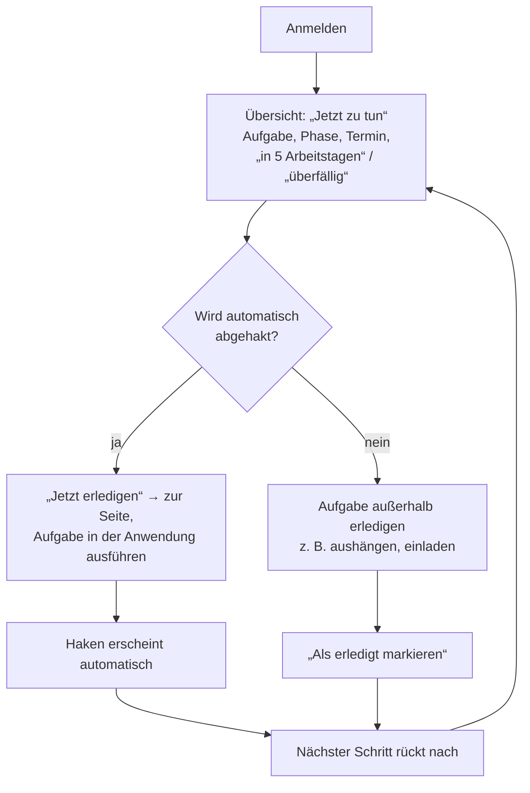

# 10 · Tägliche Arbeit mit Übersicht und Wahlkalender

[← Übersicht](README.md)

| | |
| --- | --- |
| **Rollen** | alle; was angezeigt wird, hängt von der Rolle ab |
| **Auslöser** | Ein Mitglied des Wahlvorstands meldet sich an und will wissen, was als Nächstes zu tun ist |
| **Ergebnis** | Der nächste fällige Schritt ist erledigt oder abgehakt; keine Frist wird übersehen |

## Ablauf

## Was die Übersicht zeigt

| Rolle | Inhalt |
| --- | --- |
| `vorsitz`, `mitglied` | Status der Wahl, Zahl der Wahlberechtigten, **Jetzt zu tun** mit Frist und Knopf „Jetzt erledigen“, darunter die nächsten vier offenen Schritte |
| `vorsitz` während der Einrichtung | Fortschritt des Einrichtungsassistenten, Knopf „Einrichtung fortsetzen“ |
| `wahlhelfer` | Wahltag mit Datum und Knopf „Wahltag-Ansicht öffnen“ |
| `vorsitz`, `admin` | Warnhinweis, wenn bei einer Wahl die Aufbewahrungsfrist abgelaufen ist |
| `datenschutz` | Stand der Datenschutz-Unterlagen (eingereicht, geändert, offen; Zahl der offenen Aufgaben) mit Knopf zu den Unterlagen |

## Werkzeuge für den Überblick

| Seite | Zweck | Wo |
| --- | --- | --- |
| Wahlkalender | Alle Termine mit Datum, Uhrzeit des Fristendes, Rechtsgrundlage und Erledigt-Status; Uhrzeiten einzeln oder für alle auf den Dienstschluss setzen; Kalender neu berechnen (vorsitz) | `/wahl/:id` |
| Aushänge | Welches Dokument hängt wann wo aus bzw. liegt zur Einsicht aus – Status *kommt*, *hängt*, *beendet*; ungeprüfte Zeiträume sind markiert | `/wahl/:id/aushaenge` |
| Checklisten | Standardpunkte je Phase (Vorbereitung, Wahltag, Abschluss), eigene Punkte ergänzen | `/wahl/:id/checklisten` |
| Sitzungen | Niederschrift über Sitzungen des Wahlvorstands | `/wahl/:id/sitzung` |
| Fristenrechner | Fristen unabhängig von der Wahl ausrechnen (Arbeitstage, Feiertage in BW) | `/fristen` |
| Phasen-Navigation | Phasen mit Status (erledigt ✓, aktuell hervorgehoben, offen); darunter die Seiten der aktiven Phase | Kopfzeile |

## Regeln hinter „Jetzt zu tun“

- Der nächste Schritt ist der erste nicht erledigte Termin in zeitlicher Reihenfolge; der Wahltag zählt mit.
- Automatisch abgehakt wird nur, was die Anwendung sicher erkennen kann: Freigaben, Entscheidungen und abgelaufene Fristen.
- Tätigkeiten außerhalb der Anwendung (aushängen, einladen) müssen von Hand abgehakt werden. Ist ein solcher Schritt überfällig, fragt die Übersicht: „Schon erledigt? Dann bitte abhaken.“
- Arbeitstage zählen nach § 55 LPVGWO: Montag bis Freitag ohne gesetzliche Feiertage in Baden-Württemberg, Heiligabend und Silvester.
