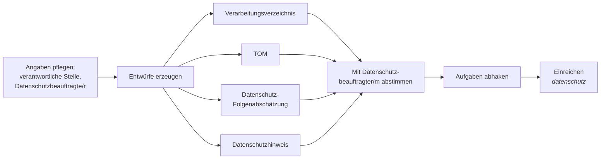

# 11 · Administration und Datenschutz

[← Übersicht](README.md)

| | |
| --- | --- |
| **Rollen** | `admin`, `vorsitz`, `datenschutz` |
| **Auslöser** | Vor dem Start der Wahl (Datenschutz-Unterlagen) und laufend (Kontrolle) |
| **Ergebnis** | Datenschutz-Dokumentation liegt vor und ist von der/dem Datenschutzbeauftragten eingereicht; Zugriffe sind nachvollziehbar |

## Datenschutz-Unterlagen

| # | Wer | Was | Wo |
| --- | --- | --- | --- |
| 1 | admin, vorsitz, datenschutz | Angaben zur verantwortlichen Stelle und zur/zum Datenschutzbeauftragten pflegen (Voraussetzung für den Einrichtungsschritt „Datenschutz“) | *Verwaltung → Datenschutz-Unterlagen* (`/datenschutz`) |
| 2 | alle | Entwürfe ansehen und drucken | `/datenschutz/:dok` |
| 3 | admin, vorsitz, datenschutz | Offene Aufgaben abhaken, z. B. Abstimmung mit der/dem Datenschutzbeauftragten | `/datenschutz` |
| 4 | datenschutz | Unterlagen einreichen, optional mit Anmerkung für den Wahlvorstand; Voraussetzung: alle Angaben sind ausgefüllt | `/datenschutz` |
| 5 | vorsitz, mitglied | Stand der Einreichung sehen: eingereicht (wann, von wem, Anmerkung), nach Einreichung geändert oder noch offen | `/datenschutz` |

### Zugang für die/den Datenschutzbeauftragte(n)

Die Rolle `datenschutz` ist – wie `admin` – bewusst von der Wahl getrennt: Sie sieht weder
Wählerverzeichnis noch Wahlvorschläge, Kalender oder Audit-Log, sondern nur die
Datenschutz-Unterlagen und die Übersicht mit deren Stand.

- **Einreichen** vermerkt Zeitpunkt, Person und Anmerkung; im Audit-Log als
  „Datenschutz-Unterlagen eingereicht“.
- Werden die Angaben **nach** der Einreichung noch einmal gespeichert (von wem auch
  immer), steht die Einreichung auf „nach Einreichung geändert“ und kann erneut
  eingereicht werden.
- Die Einreichung lässt sich zurückziehen („Einreichung zurückziehen“).
- Solange eine aktuelle Einreichung vorliegt, gilt die Aufgabe „Datenschutz-Folgenabschätzung
  mit der/dem Datenschutzbeauftragten abstimmen und freigeben“ als erledigt. Ohne DSB-Konto
  lässt sie sich weiterhin von Hand abhaken.

## Kontrolle über das Audit-Log

| # | Wer | Was | Wo |
| --- | --- | --- | --- |
| 1 | admin, vorsitz | Nachsehen, wer wann was geändert hat (z. B. Stimmabgabe vermerkt, Ergebnis festgestellt, Wahl gelöscht) | *Verwaltung → Audit-Log* (`/audit`) |

Das Audit-Log enthält keine Inhalte, nur Aktion, Objekt und Feldnamen; IP-Adressen nur als HMAC.

## Fristregeln

| # | Wer | Was | Wo |
| --- | --- | --- | --- |
| 1 | vorsitz | Jede Fristregel gegen den amtlichen Text prüfen und als geprüft markieren; Empfehlungen ohne gesetzliche Frist sind gekennzeichnet | *Verwaltung → Fristregeln* (`/fristen/regeln`) |

## Nur in der Entwicklung

`admin` sieht außerhalb der Produktion den Menüpunkt *Neu starten (Entwicklung)*
(`/entwicklung`), der alle Wahldaten löscht und die Benutzerkonten behält. Gleiches
leistet `pnpm dev:reset --ja`.
