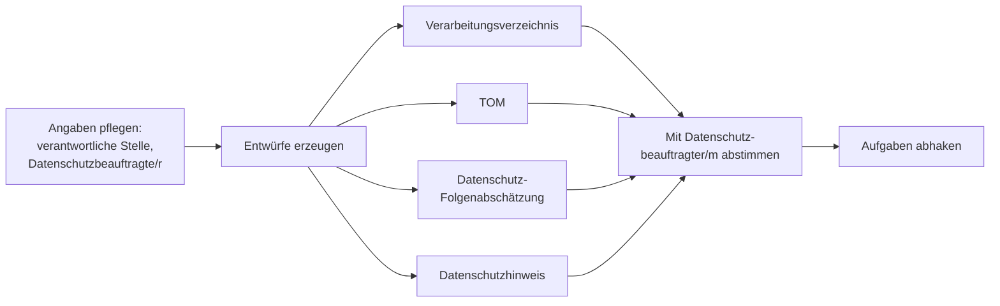

# 11 · Administration und Datenschutz

[← Übersicht](README.md)

| | |
| --- | --- |
| **Rollen** | `admin`, `vorsitz` |
| **Auslöser** | Vor dem Start der Wahl (Datenschutz-Unterlagen) und laufend (Kontrolle) |
| **Ergebnis** | Datenschutz-Dokumentation liegt als Entwurf vor und ist abgestimmt; Zugriffe sind nachvollziehbar |

## Datenschutz-Unterlagen

| # | Wer | Was | Wo |
| --- | --- | --- | --- |
| 1 | admin, vorsitz | Angaben zur verantwortlichen Stelle und zur/zum Datenschutzbeauftragten pflegen (Voraussetzung für den Einrichtungsschritt „Datenschutz“) | *Verwaltung → Datenschutz-Unterlagen* (`/datenschutz`) |
| 2 | alle | Entwürfe ansehen und drucken | `/datenschutz/:dok` |
| 3 | admin, vorsitz | Offene Aufgaben abhaken, z. B. Abstimmung mit der/dem Datenschutzbeauftragten | `/datenschutz` |

## Kontrolle über das Audit-Log

| # | Wer | Was | Wo |
| --- | --- | --- | --- |
| 1 | admin, vorsitz | Nachsehen, wer wann was geändert hat (z. B. Stimmabgabe vermerkt, Ergebnis festgestellt, Wahl gelöscht) | *Verwaltung → Audit-Log* (`/audit`) |

Das Audit-Log enthält keine Inhalte, nur Aktion, Objekt und Feldnamen; IP-Adressen nur als HMAC.

## Fristregeln

| # | Wer | Was | Wo |
| --- | --- | --- | --- |
| 1 | vorsitz | Jede Fristregel gegen den amtlichen Text prüfen und als geprüft markieren; Empfehlungen ohne gesetzliche Frist sind gekennzeichnet | *Verwaltung → Fristregeln* (`/fristen/regeln`) |

## Nur in der Entwicklung

`admin` sieht außerhalb der Produktion den Menüpunkt *Neu starten (Entwicklung)*
(`/entwicklung`), der alle Wahldaten löscht und die Benutzerkonten behält. Gleiches
leistet `pnpm dev:reset --ja`.
