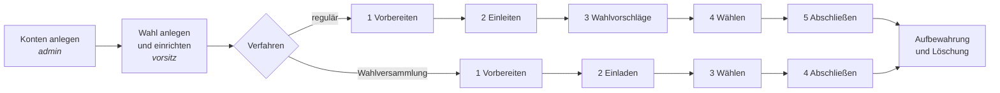

# User-Journeys

Diese Seiten beschreiben, wie die Beteiligten mit dem JAV-Wahl-Tool arbeiten – von der
Anlage der Benutzerkonten bis zur Löschung der Wahldaten. Jede Journey nennt die
handelnde Rolle, den Auslöser, die einzelnen Schritte mit der zugehörigen Seite und das
Ergebnis. Schutzmechanismen und typische Stolpersteine stehen jeweils am Ende.

> [!NOTE]
> Die Journeys beschreiben das Verhalten der Anwendung, nicht die Rechtslage. Fristen und
> Rechtsgrundlagen sind dem Code entnommen (`src/lib/fristen/index.ts`) und vor einem
> Einsatz gegen LPVG und LPVGWO zu prüfen.

## Rollen

| Rolle                                    | Wer                                       | Typische Journeys                                                                                                                    |
| ---------------------------------------- | ----------------------------------------- | ------------------------------------------------------------------------------------------------------------------------------------ |
| `admin` – Administration (IT)            | IT der Dienststelle                       | [Zugang](01-zugang-und-konten.md), [Administration](11-administration-und-datenschutz.md), [Löschung](08-abschluss-und-loeschung.md) |
| `vorsitz` – Vorsitz Wahlvorstand         | Vorsitzende/r des Wahlvorstands           | alle Journeys; allein zuständig für Anlage, Freigaben und Feststellung des Ergebnisses                                               |
| `mitglied` – Mitglied Wahlvorstand       | weitere Mitglieder des Wahlvorstands      | Wählerverzeichnis, Einsprüche, Wahlvorschläge, Wahltag, Auszählung                                                                   |
| `wahlhelfer` – Wahlhelfer/in             | Helferinnen und Helfer am Wahltisch       | [Wahltag](06-wahltag.md) (Stimmabgabe vermerken), Fristen einsehen                                                                   |
| `datenschutz` – Datenschutzbeauftragte/r | Datenschutzbeauftragte/r der Dienststelle | [Datenschutz](11-administration-und-datenschutz.md): Unterlagen ausfüllen und einreichen; kein Zugriff auf Wahldaten                 |

Die Rechte im Detail stehen in [src/lib/rbac.ts](../../src/lib/rbac.ts) und im
[README](../../README.md#rollen-und-berechtigungen).

## Gesamtablauf

Die Anwendung kennt zwei Verfahren. Das **reguläre Verfahren** hat fünf Phasen, die
**Wahlversammlung** (höchstens 20 Wahlberechtigte) vier. Die Phasen erscheinen erst in der
Navigation, wenn der Einrichtungsassistent abgeschlossen ist.

## Journeys

| Nr. | Journey                                                                  | Rolle(n)                      | Phase            |
| --- | ------------------------------------------------------------------------ | ----------------------------- | ---------------- |
| 01  | [Zugang und Benutzerkonten](01-zugang-und-konten.md)                     | admin, alle                   | vor der Wahl     |
| 02  | [Wahl anlegen und einrichten](02-wahl-anlegen-und-einrichten.md)         | vorsitz                       | vor der Wahl     |
| 03  | [Wahl vorbereiten](03-vorbereiten.md)                                    | vorsitz, mitglied             | 1 Vorbereiten    |
| 04  | [Wahl einleiten](04-einleiten.md)                                        | vorsitz, mitglied             | 2 Einleiten      |
| 05  | [Wahlvorschläge bearbeiten](05-wahlvorschlaege.md)                       | vorsitz, mitglied             | 3 Wahlvorschläge |
| 06  | [Briefwahl und Wahltag](06-wahltag.md)                                   | vorsitz, mitglied, wahlhelfer | 4 Wählen         |
| 07  | [Auszählung und Ergebnis](07-ergebnis.md)                                | vorsitz, mitglied             | 5 Abschließen    |
| 08  | [Abschluss, Aufbewahrung und Löschung](08-abschluss-und-loeschung.md)    | vorsitz, admin                | 5 Abschließen    |
| 09  | [Wahlversammlung (vereinfachtes Verfahren)](09-wahlversammlung.md)       | vorsitz, mitglied             | alle             |
| 10  | [Tägliche Arbeit mit Übersicht und Wahlkalender](10-taegliche-arbeit.md) | alle                          | durchgehend      |
| 11  | [Administration und Datenschutz](11-administration-und-datenschutz.md)   | admin, vorsitz, datenschutz   | durchgehend      |

## Verwendung im GitHub-Wiki

Die Dateien sind so geschrieben, dass sie auch als Wiki-Seiten funktionieren: GitHub
rendert die Mermaid-Diagramme in beiden Fällen. Beim Kopieren ins Wiki die Links
anpassen – Wiki-Seiten werden ohne `.md` verlinkt (`[Wahltag](06-wahltag)`), und Links
auf Quelldateien brauchen die volle Repository-URL.
